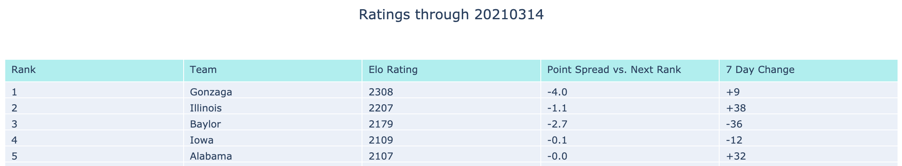
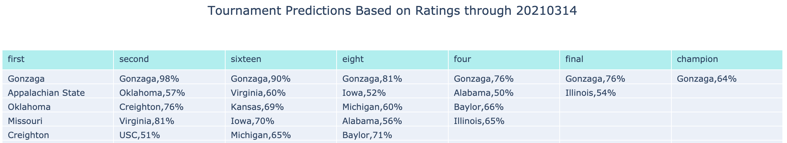
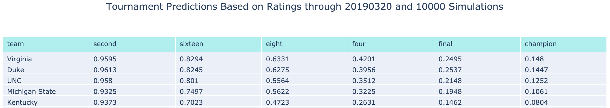
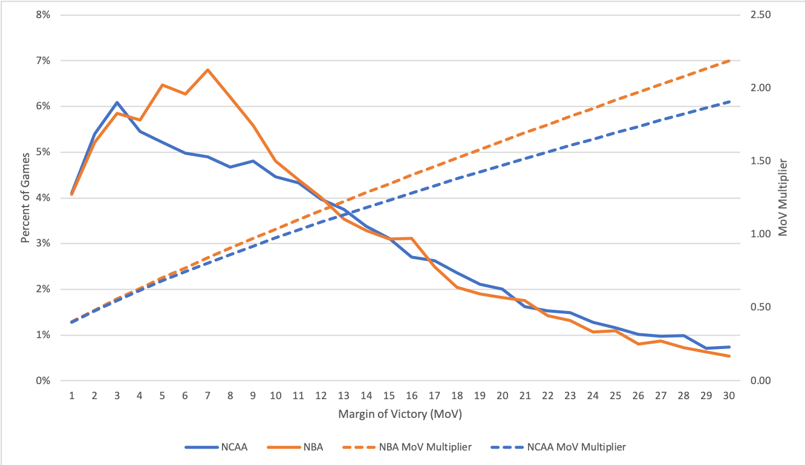
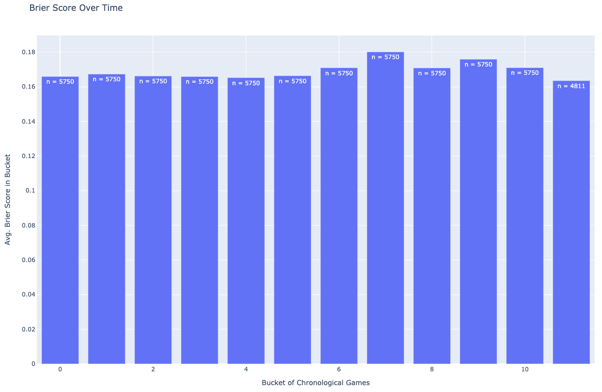
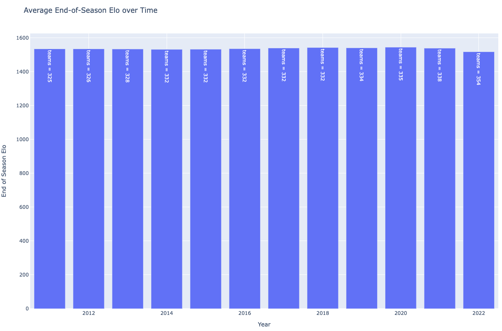
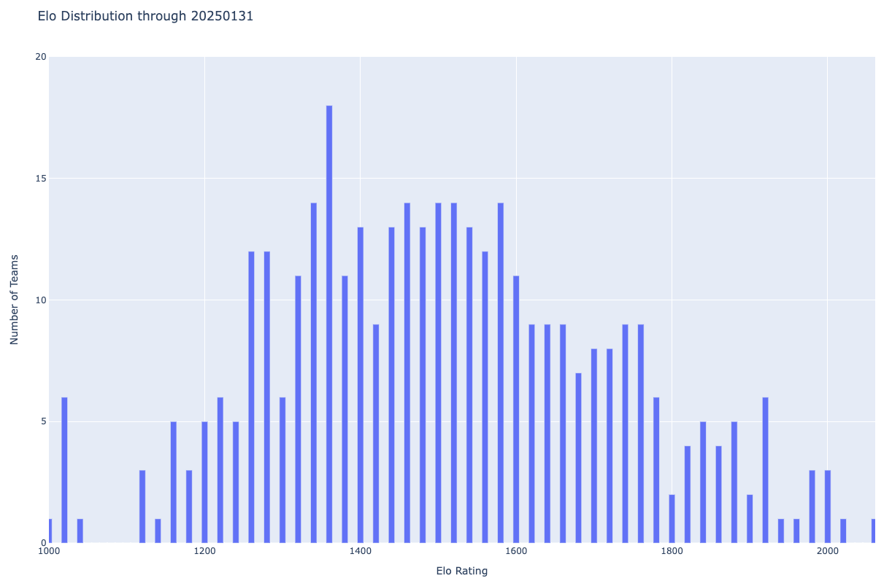
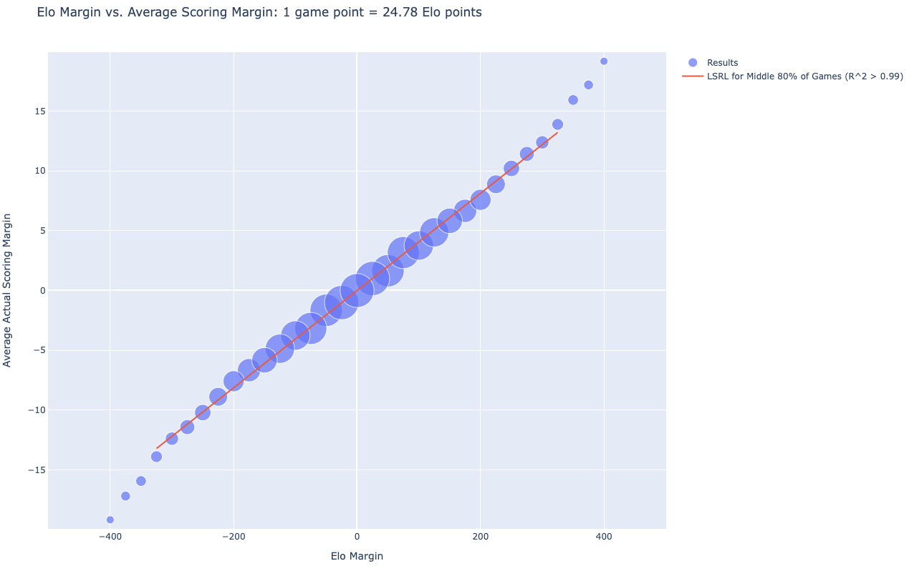
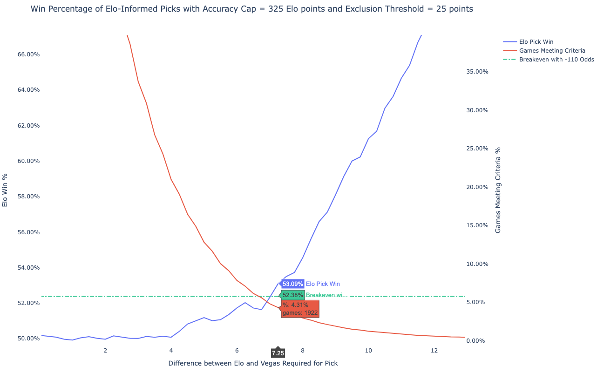
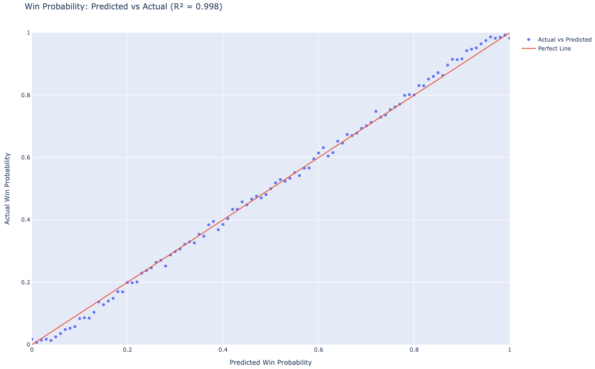

[](https://github.com/AnthonyErr/college-basketball-elo/actions/workflows/daily_predictions.yml)
[](https://github.com/AnthonyErr/college-basketball-elo/actions/workflows/weekly_rankings.yml)

# college-basketball-elo

Team ratings and game predictions for NCAA Division I men's college basketball, with game data going back to the 2010-11 season. Use it to:

- rank teams as of any date since 2010
- predict every game on today's schedule, with live Vegas spreads alongside for comparison
- predict a single matchup, home or neutral site
- fill out a bracket, or simulate a tournament thousands of times to get each team's odds of reaching each round

The default rating engine is a **Kalman filter** (`kalman.py`). In backtests on seasons it was never tuned on, it is more accurate than the original Elo model in every week of the season. Each team's preseason rating comes from its **roster**: how much of last season's production returns, and what incoming transfers and recruits bring, with each transfer judged by how good the team he produced for was (`rosters.py`). Its ratings are reported on the familiar Elo scale (about 1500 for an average D1 team, 24.78 rating points = 1 point of spread), so rankings and spreads read the same way. The Elo model is still available: set `RATING_MODEL = 'elo'` at the top of `elo.py`.

A GitHub Actions workflow runs every morning to fetch yesterday's results, update the ratings, predict the day's games, and commit the results. **[Today's predictions](docs/index.md)** are in `docs/index.md`.

This repository is a fork of [grdavis/college-basketball-elo](https://github.com/grdavis/college-basketball-elo), which built the original Elo model, the data pipeline, and the visualizations in the Elo sections below.

## Contents
- [Automated runs](#automated-runs)
- [Setup](#setup)
- [Usage](#usage): [elo.py](#elopy-rankings), [predictions.py](#predictionspy-predictions), [backtest.py](#backtestpy-accuracy)
- [Methodology](#methodology): [Kalman filter](#kalman-filter-ratings-default), [Elo](#elo-ratings)
- [Performance](#performance)
- [Elo tuning notes](#elo-tuning-notes)
- [Data sources and repository layout](#data-sources-and-repository-layout)
- [Troubleshooting the workflows](#troubleshooting-the-workflows)

## Automated runs

| Workflow | When | What it does |
|---|---|---|
| `daily_predictions.yml` | Every day at 14:23 UTC (9:23 AM ET in winter), or on demand | `python predictions.py -A`: fetches results through yesterday and this season's player stats, updates ratings, predicts today's games, writes `Outputs/`, `docs/index.md` and `docs/index.html`, publishes to Datawrapper, and commits |
| `weekly_rankings.yml` | Mondays at 17:17 UTC, or on demand | `python elo.py -t 50`: fetches results and player stats, updates ratings, and commits a top 50 ranking to `Outputs/` |
| `tournament_predictions.yaml` | On demand | Predicts a single bracket for `Data/latest_tournament.csv` |
| `tournament_sims.yml` | On demand | Runs 10,000 simulations of `Data/latest_tournament.csv` |

Scheduled runs are set off the top of the hour, when GitHub most often delays or drops them. The two scheduled workflows share a concurrency group, so they never push at the same time.

**Datawrapper (optional).** The daily run publishes interactive tables to [Datawrapper](https://www.datawrapper.de/) when these repository secrets are set. Without them it falls back to plain tables in `docs/`.

| Secret | Used for |
|---|---|
| `DATAWRAPPER_API_TOKEN` | Required for any Datawrapper publishing |
| `DW_PREDICTIONS_CHART_ID` | Updates an existing predictions chart instead of creating a new one |
| `DW_RANKINGS_CHART_ID` | Updates an existing top 100 rankings chart |
| `DW_PROBABILITIES_CHART_ID` | Shows a tournament probabilities chart on the daily page |

**Web page.** `docs/index.html` is rebuilt every day. To serve it as a website, turn on GitHub Pages for this repository (Settings → Pages → deploy from branch `main`, folder `/docs`).

## Setup

The code runs on Python 3.8 (the workflows use 3.8.15, because several dependencies are pinned to versions that need it).

```
python -m venv .venv
.venv\Scripts\activate        # Windows; use source .venv/bin/activate on macOS/Linux
pip install -r requirements.txt
```

The game and player data are in the repository, so there is nothing to download first. Each run fetches any games completed since the latest data file, through yesterday, and refreshes this season's player stats (at most every 6 hours). The first rating run on new data takes about a minute; results are then cached in `.cache/`, so later runs on the same data load in a second or two. `predictions.py` keeps only the 3 most recent data files, spreads files, and daily prediction files, deleting older ones.

## Usage

All dates are `YYYYMMDD`. Every command accepts `-h` for help.

#### elo.py: rankings
```
python elo.py
```
Fetches results through yesterday, updates the ratings, and shows the top 25 teams with their rating, the point spread over the next-ranked team, and the change over the last 7 days. The table opens in a browser when a display is available, and is always saved as a CSV in `Outputs/`.

| Option | Meaning |
|---|---|
| `-t`, `--topteams` | How many teams to show (default 25) |
| `-d`, `--date` | Show the rankings as of a past date |
| `-p`, `--period` | Days to use for the rating change column (default 7) |


*Example output (Elo model, March 2021).*

#### predictions.py: predictions

**Today's games** (the default):
```
python predictions.py
python predictions.py -F 20210322 -d 20210321
```
Predicts every game on the [Scores and Odds](https://www.scoresandodds.com/ncaab) schedule for today, or for the date given with `-F`. Each row has both teams' win probabilities and predicted spreads, the live Vegas spread, the gap between the two, and whether the game is at a neutral site (from [TeamRankings](https://www.teamrankings.com/ncb/schedules/season/)). Teams marked `*` have no games in the model yet, so treat those predictions with caution. The second command shows what the model would have picked on 3/22/2021 using only games through 3/21/2021.

**One game:**
```
python predictions.py -G UConn Maryland -n
```
The first team is home; `-n` means a neutral site. For the 2021 NCAA tournament first round, with ratings through the day before (`-d 20210319`):
```
Ratings through 20210319
UConn vs. Maryland @ neutral site
UConn 58% -2.0 Maryland 42% 2.0
```
Team names don't have to match the data exactly. Capitalization doesn't matter, common names work (`North Carolina` → `UNC`, `Connecticut` → `UConn`, `Pittsburgh` → `Pitt`, `Loyola Chicago` → `Loyola (IL)`; the list is `TEAM_ALIASES` in `predictions.py`), and typos switch to the closest match. Every switch is printed, for example `Auto team switch: "Marylnd" -> "Maryland"`. A name with nothing close stops the prediction instead of being treated as a brand-new team.

**A bracket:**
```
python predictions.py -P Data/tournament_results_2021.csv -m 1
```
The first column of the file must list a power of 2 teams in matchup order: row 1 plays row 2, the winner plays the winner of rows 3 and 4, and so on. Other columns are ignored. The output adds a column per round, with each winner's probability of winning that game. `-m` decides each game: `0` picks winners at random according to their win probability (default), `1` always picks the favorite, `2` flips a coin.



**Tournament simulations:**
```
python predictions.py -S Data/tournament_results_2019.csv 10000 -d 20190320
```
Plays the bracket out 10,000 times and reports the share of simulations in which each team reached each round, sorted by championship odds. Here `-d` uses ratings from the day before the 2019 tournament.



| Option | Meaning |
|---|---|
| `-F`, `--ForecastDate` | Predict games on this date instead of today. For a past date, add `-d` |
| `-G`, `--GamePredictor` | Predict one game: home team, then away team |
| `-n`, `--neutral` | With `-G`: neutral site, no home-court advantage |
| `-P`, `--PredictBracket` | Predict one bracket from this file |
| `-m`, `--mode` | With `-P`: `0` probabilistic (default), `1` favorite, `2` coin flip |
| `-S`, `--SimMode` | Simulate this bracket file this many times |
| `-r`, `--round` | With `-P` or `-S`: start from this column of the bracket file (0 = first) |
| `-o`, `--output` | With `-S`: also save the probabilities CSV to this path |
| `--datawrapper` | With `-S`: publish the probabilities table to Datawrapper (needs `DATAWRAPPER_API_TOKEN`; uses `DW_PROBABILITIES_CHART_ID` if set) |
| `-d`, `--dateSim` | Use ratings as of this date. Works with every mode |
| `-A`, `--auto` | Used by the daily workflow to adjust for the runner's UTC clock |

All prediction tables are also saved as CSVs in `Outputs/`.

#### backtest.py: accuracy
```
python backtest.py
```
Replays every season and scores each morning's predictions using only games from earlier days, exactly as the daily run works. It reports Brier score, log loss, how much further the predicted spreads land from the final margins than the closing Vegas spread does, and how often the model's side covers when it disagrees with the line by 3+ points, all by week of the season. Seasons before the split are the tuning period and are reported separately from the held-out test seasons.

| Option | Meaning |
|---|---|
| `-m`, `--model` | `kalman`, `elo`, or `both` (default) |
| `-s`, `--split` | First season of the held-out test (default 2021) |

#### rosters.py: player data
```
python rosters.py --download 2009 2026
python rosters.py --fit
```
`--download` re-downloads player stats for a range of seasons (start years, so 2025 is 2025-26) into `Data/players/`. `--fit` refits the preseason roster model on the 2013-14 through 2020-21 seasons and prints new `ROSTER_COEFS` to paste into `kalman.py`. If Torvik adds a team name that isn't in `Data/torvik_mapping.csv`, the download prints a warning naming it.

## Methodology

#### Kalman filter ratings (default)
Each team has a hidden strength, measured in points relative to an average D1 team. The filter tracks a best estimate of every team's strength, plus a covariance matrix: how uncertain each estimate is, and how the estimates are linked through common opponents. Home-court advantage is part of the state as well and is learned from the data (currently about 3.2 points).

Every game day:
1. **Drift.** Every team's uncertainty grows a little (0.1 points² per day), because teams change during a season.
2. **Predict.** A game's predicted home margin is home strength − away strength + home-court advantage (none at a neutral site). The win probability is `Φ(margin / sqrt(100 + uncertainty))`, where Φ is the normal distribution and the uncertainty comes from the covariance, so games involving teams the model knows little about get less extreme probabilities.
3. **Update.** All of the day's games are folded in at once, each giving two observations: the final margin (noise variance 110) and, when there is one, the closing Vegas spread (noise variance 40). The market knows about injuries, roster turnover, and the transfer portal, so early in the season, when the filter is uncertain, results and lines move ratings a lot. By February ratings have settled and move much less. Because the covariance is tracked, a result also moves teams connected to the two that played, which is how a non-conference upset informs the rest of a conference.

**Preseason ratings from rosters.** Each offseason, a D1 team's new rating is predicted from last season's rating and its conference, plus what its roster returns and brings in. Player stats come from [Bart Torvik](https://barttorvik.com/). Each player's **level** is his old team's rating, adjusted by how his box plus-minus compared to his teammates'. Then, for the new season's roster:

| Input | What it measures | Effect |
|---|---|---|
| Last season's rating | Where the team was | × 0.71 |
| Conference average | Pull toward the conference | × 0.25 |
| Returning share | Share of last season's minutes played by players who are back | +7.8 pts if everyone returns |
| Returning value | Whether the returners were better than the team as a whole | × 0.69 |
| Transfer share | Share of minutes coming from players who transferred in (from their old teams) | +7.4 pts per 100% |
| Transfer value | How far above **their new team** the transfers' levels are, weighted by minutes | × 0.62 |
| Recruits | Incoming freshmen, graded by recruiting rating: 1 for a 100-rated recruit, scaling down to 0 at 70 | +1.1 pts per 1 |

Because transfers are measured against their new team, a 10-point scorer from a top-10 team is a big upgrade for a bottom-100 team, while a star from a weak team adds little to a contender. Transfers' share of minutes grew from 2% in 2013-14 to 32% in 2025-26, which is why this matters more every year. These teams get 3.5 points of preseason uncertainty. Non-D1 teams, and seasons without player data, fall back to regressing 25% toward the conference average with 4 points of uncertainty. Teams new to the system (mostly non-D1 opponents) start 35 points below an average D1 team with 12 points of uncertainty. To keep the filter fast, non-D1 teams idle for 30 days are dropped from the state, which in a Kalman filter doesn't change any other team's rating.

Compared to Elo, this replaces the hand-tuned pieces (K-factor, margin-of-victory multiplier, market adjustment schedule) with one probabilistic model, where each game's weight comes from how uncertain the ratings involved are. All settings are at the top of `kalman.py`.

#### Elo ratings
The Elo model follows FiveThirtyEight's [NBA](https://fivethirtyeight.com/features/how-we-calculate-nba-elo-ratings/) and [NFL](https://fivethirtyeight.com/methodology/how-our-nfl-predictions-work/) methodology, with tuning for college basketball. Every team starts at 1500. Ratings rise after wins and fall after losses, and the winner gains what the loser gives up. Settings are at the top of `elo.py`.

**Predictions.** For a rating difference `elo_spread` (including home court):
```
win_probability = 1 / (1 + 10**(-elo_spread/400))
point_spread    = elo_spread / -24.78
```
For example, a +183 rating edge is a 74% win probability and a 7.4-point spread. Home teams get **+82** rating points (3.3 points); neutral sites get none.

**Updates.** How much a rating moves depends on how surprising the result was and the margin of victory:
```
MoV_multiplier = ((MoV + 2.5)**0.7) / (6 + 0.006 * elo_margin)
winner_change  = K * MoV_multiplier * (1 - winner_win_probability)
```
with **K = 34**. When 63% favorite Alabama beat LSU 80-79 in the 2021 SEC final, Alabama gained only 5 points: it was expected to win by more. When 30% underdog Georgetown beat Creighton 73-48 in the 2021 Big East final, Georgetown gained 35.

**Early-season market adjustment.** In November a team's rating is mostly last season's, but with the transfer portal the roster may look nothing like last year's. After each game's normal update, both teams are nudged toward the closing Vegas spread:
```
market_weight = 0.1 + 0.5 * exp(-avg_games_played_this_season / 10)
home_change   = market_weight * (vegas_home_margin - elo_home_margin) * 24.78 / 2
away_change   = -home_change
```
The pull starts at about 0.6 of the gap and fades toward 0.1 as teams play games. Games without a line are skipped. Set `MARKET_WEIGHT` and `MARKET_FLOOR` to 0 in `elo.py` to turn it off.

**Seasons and new teams.** Each offseason every rating becomes `0.64 × rating + 0.36 × conference average`. Teams new to the system start at **985** (21-point underdogs to an average team), and teams with fewer than **10** games in a season are dropped at the end of it.

## Performance

#### Held-out results
The Kalman filter was tuned to minimize Brier score on the 2013-14 through 2020-21 seasons only, using a coordinate search over about 40 configurations, and the roster model was fit on the same seasons. Everything from 2021-22 on was held out as a test. `backtest.py` reproduces these numbers.

Held-out seasons, 2021-22 through 2026-27 so far (about 31,000 games). "Spread error vs. Vegas" is how much further the predicted spread lands from the final margin than the closing line does, in points (lower is better):

| Model | Brier | Log loss | Spread error vs. Vegas | Covers when 3+ pts off the line |
|---|---|---|---|---|
| Original Elo (K = 47, no market adjustment) | 0.1721 | 0.5113 | +0.41 | 49.9% |
| Elo with market adjustment (`RATING_MODEL = 'elo'`) | 0.1671 | 0.4982 | +0.16 | 50.1% |
| Kalman filter without rosters (`ROSTER_COEFS = None`) | 0.1662 | 0.4936 | +0.12 | 52.1% |
| **Kalman filter with roster preseason (default)** | **0.1656** | **0.4919** | **+0.07** | 53.3% |

Spread error vs. Vegas by week of the season, with the Kalman filter without rosters in parentheses:

| Week | 1 | 2 | 3 | 4-5 | 6-8 | 9-12 | 13+ |
|---|---|---|---|---|---|---|---|
| With rosters (without) | +0.23 (+0.59) | +0.05 (+0.19) | +0.08 (+0.14) | +0.14 (+0.18) | −0.02 (+0.01) | +0.06 (+0.06) | +0.06 (+0.06) |

The roster model cut the week-1 gap to Vegas by 60%, and weeks 1-3 improved in every held-out season. Across all held-out games the improvement is about 5 standard errors for Brier and 7 for spread error, so it isn't noise. By February the games themselves have taken over and the two versions agree.

One caveat: the backtest knows each season's full roster (every player who appeared in a game that season), while the daily run only knows players who have appeared so far. On opening night it has no current-season rosters and uses the old regression; within a few days nearly every team is covered. Players who sit out a whole season, for example with an injury, are also invisible to the backtest. Real early-season gains are likely a little smaller than above.

**Blending in Elo** was also tested: a second Kalman filter learning how much to trust the Kalman and Elo predictions game by game. The two engines' errors are 94% correlated (99% by February), and the blend improved held-out Brier by only 0.00005. Even blend weights picked with hindsight on the test seasons gained just 0.0002, so the ratings use the Kalman filter alone.

What tuning found:
- Teams change more within a season than expected; more daily drift was better.
- The closing line is a strong observation but shouldn't overrule results: a market noise variance of 40 beat 9, 16, 25, and 80.
- Shared conference-wide preseason uncertainty and capping blowout margins both made predictions worse.
- An old rating-based home-court tweak (a bigger boost for weak home teams, a smaller one for strong ones) made held-out predictions worse with both current models and was removed.

#### Is there a betting edge?
Probably not against closing lines:
- When the Kalman filter disagrees with the closing line by 3+ points, its side covered 55.8% of the time in the tuning seasons but 53.3% in the held-out seasons (about 2,750 games). That's only about one standard error above the 52.4% needed to break even at -110, and some of it may come from the backtest's roster hindsight described above. Before the roster model, the held-out rate was 52.1%, and it had drifted from 55-63% in some early seasons down to about 48-51% from 2024-25 on, so the market has gotten sharper.
- Betting only when the disagreement is large relative to the filter's own uncertainty helped in the tuning seasons but not in the held-out seasons.
- Simple angles against the closing line, 2013-2026: home teams cover 49.9%, and the average final margin is 1.004 × the line. Rest days, back-to-backs, last season's results, and conference vs. non-conference games were all within noise. The one pattern outside noise: home favorites of 12-18 points cover only 47.8% (about 7,000 games), so betting the underdog there wins about 52.2%, right at break-even.

The model is most useful as an accurate, independent read on each game, not as a betting system. This is not gambling advice; please bet responsibly.

## Elo tuning notes
These notes and charts come from tuning the Elo model, using data through early 2025. `tuning.py` recreates them.

The Elo model's K-factor, home-court advantage, and season carryover were tuned to minimize the average [Brier score](https://en.wikipedia.org/wiki/Brier_score), the squared difference between predicted win probability and the result (1 for a win, 0 for a loss), skipping the first 3 seasons while ratings settle.
- **K = 34** is much larger than FiveThirtyEight's NBA value of 20, partly because ratings in college basketball are spread much wider. Before the market adjustment the best K was 47; the adjustment now does some of the work of moving ratings quickly.
- **Home court +82** (3.3 points) is less than the raw 2010-2020 average home margin of 7.1 points, which is inflated by lopsided "guarantee games" that strong teams always host.
- **Carryover 0.64** is lower than the NBA's 0.75, which fits the heavier roster turnover in college. Reverting toward the conference average rather than the overall average keeps strong conferences strong.
- **New teams at 985** and a margin-of-victory multiplier slightly damped from FiveThirtyEight's NBA version:



Average Brier score by season stayed stable, with a slight rise around Covid:


The average rating stays near 1500, dipping when many new teams join at 985:


The rating distribution is centered near 1500 with a long right tail of standout teams:


24.78 rating points equal 1 point of spread, from a linear fit to the middle 80% of games. The fit holds up to about a 300-point (12-point spread) difference:


How often Elo-informed picks beat the Vegas spread as the disagreement grows (blue), the share of games that qualify (red), and the 52.38% break-even (green):


Predicted win probability vs. actual win rate. Teams given an X% chance won about X% of the time (R² ≈ 0.99):


## Data sources and repository layout
- **Scores and spreads:** [Scores and Odds](https://www.scoresandodds.com/ncaab) since the 2023-24 season. Earlier scores came from [Sports Reference](https://www.sports-reference.com/cbb/) and earlier spreads from [SportsBookReviewsOnline](https://www.sportsbookreviewsonline.com/scoresoddsarchives/ncaabasketball/ncaabasketballoddsarchives.htm).
- **Neutral sites:** the [TeamRankings](https://www.teamrankings.com/ncb/schedules/season/) schedule.
- **Player stats:** [Bart Torvik](https://barttorvik.com/), one file per season since 2009-10, with stable player IDs that follow players through transfers. Each run downloads only the current season.

| Path | Contents |
|---|---|
| `elo.py` | Elo model, `RATING_MODEL` switch, and the rankings command |
| `kalman.py` | Kalman filter rating engine (default) |
| `rosters.py` | Player data download and the preseason roster features |
| `predictions.py` | Daily, single-game, bracket, and simulation predictions |
| `backtest.py` | Season-by-season accuracy backtest |
| `scraper.py`, `spread_enricher.py` | Fetch scores, schedules, neutral sites, and live spreads |
| `datawrapper_publisher.py` | Publishes tables to Datawrapper and builds `docs/index.html` |
| `tuning.py` | Elo tuning and the charts above |
| `Data/` | Game data (`YYYYMMDD-YYYYMMDD.csv`: neutral flag, away team, away score, home team, home score, date, away spread), `conferences.csv`, team name mappings between sources (including `torvik_mapping.csv`), tournament brackets |
| `Data/players/` | Player season stats by season start year: Torvik player ID, team, class, minutes %, box plus-minus, recruiting rating |
| `New_Spreads/` | Recent live-spread snapshots |
| `Outputs/` | Prediction and ranking CSVs, with tournament results by season |
| `docs/` | The daily predictions page |

## Troubleshooting the workflows
- **Scheduled runs use an old version of the workflow.** GitHub can keep running a schedule against an old commit (check the commit on the run in the Actions tab). Changing the `cron` line, or disabling and re-enabling the workflow in the Actions tab, makes it pick up the latest version.
- **`Matrix is singular` in CI.** numpy 1.23 bundles an old OpenBLAS whose AVX-512 code can return wrong results on some newer runner CPUs. The workflows set `OPENBLAS_CORETYPE: Haswell` to avoid it and log the runner's CPU model. If it comes back, the error names the date and the matrix diagnostics.
- **`Version 3.8.15 ... not found`.** Python 3.8 builds only exist for Ubuntu 24.04 and older, so the workflows pin `runs-on: ubuntu-24.04`. The two on-demand tournament workflows still use `ubuntu-latest` and need the same pin before they will run.
